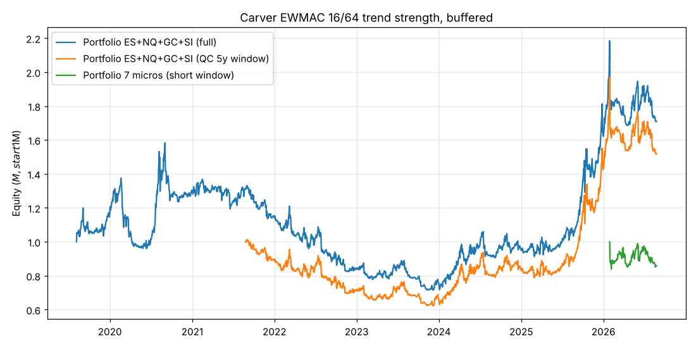

# Carver fast trend following (long/short, trend strength): local backtest

This is a port of the QuantConnect algorithm `FuturesFastTrendFollowingLongAndShortWithTrendStrenthAlgorithm`
with default parameters: EWMAC 16/64, forecast scalar 4.1,
cap +/-20, sigma span 32, 70/30 blend with the 3-year average vol,
tau 0.2, buffer 0.1, IDM from Carver Table 16, $1M starting capital (compounding).
It runs on daily session bars built from the repo's 15-minute data. A signal at day t's close fills at
day t+1's open. Costs are commission plus 1 tick of slippage per side, plus an estimated roll cost.

Regenerate with `python -m carver_trend.run_all`.

**Coverage.** "Every major future" isn't possible here because the environment has no
QuantConnect/LEAN and no outside data access. The tests use every futures series in `sample_data/`:
ES, NQ, GC and SI with 10 years of data, and MES, MNQ, MYM, M2K, MGC, SIL and MCL with about 11 months.
Rates (ZN/ZB), FX (6E/6J), grains, softs and full-size energies aren't in the repo. Running the
original algorithm on QuantConnect is still the way to get the full universe.

**Data caveat.** The continuous series look unadjusted (not Panama back-adjusted the way QC is), so
roll gaps show up as small fake returns.

### Contract specs used

| symbol   | class        |   multiplier |   tick |   cost/side $ |   rolls/yr |
|:---------|:-------------|-------------:|-------:|--------------:|-----------:|
| ES       | Equity index |         50   |  0.25  |         14.75 |          4 |
| NQ       | Equity index |         20   |  0.25  |          7.25 |          4 |
| GC       | Metals       |        100   |  0.1   |         12.25 |          6 |
| SI       | Metals       |       5000   |  0.005 |         27.25 |          5 |
| MES      | Equity index |          5   |  0.25  |          1.87 |          4 |
| MNQ      | Equity index |          2   |  0.25  |          1.12 |          4 |
| MYM      | Equity index |          0.5 |  1     |          1.12 |          4 |
| M2K      | Equity index |          5   |  0.1   |          1.12 |          4 |
| MGC      | Metals       |         10   |  0.1   |          1.62 |          6 |
| SIL      | Metals       |       1000   |  0.005 |          5.62 |          5 |
| MCL      | Energy       |        100   |  0.01  |          1.62 |         12 |

## 1. Full history (2016 data, trading after the QC 3-year warm-up)

Each instrument alone (IDM 1, weight 1) and as the 4-instrument portfolio (IDM 1.56, weight 0.25).

|                         | start      | end        |   years |   total_return_pct |   cagr_pct |   ann_vol_pct |   sharpe |   max_dd_pct |   calmar |   costs_usd |   contracts_per_year |   pct_days_long |
|:------------------------|:-----------|:-----------|--------:|-------------------:|-----------:|--------------:|---------:|-------------:|---------:|------------:|---------------------:|----------------:|
| ES                      | 2019-08-09 | 2026-08-25 |    7.04 |               11.2 |       1.52 |          22.5 |     0.18 |        -37.7 |     0.04 |       13989 |                   85 |            77.9 |
| NQ                      | 2019-08-09 | 2026-08-25 |    7.04 |               56.8 |       6.59 |          23.4 |     0.38 |        -34.6 |     0.19 |        4815 |                   59 |            76.7 |
| GC                      | 2019-08-05 | 2026-08-25 |    7.06 |              112   |      11.24 |          26.7 |     0.53 |        -55.4 |     0.2  |       13007 |                   83 |            68.7 |
| SI                      | 2019-08-05 | 2026-08-25 |    7.06 |               14.9 |       1.99 |          24.4 |     0.2  |        -59.3 |     0.03 |       19709 |                   66 |            59.7 |
| PORTFOLIO (ES+NQ+GC+SI) | 2019-08-05 | 2026-08-25 |    7.06 |               70.9 |       7.89 |          25.7 |     0.42 |        -54.8 |     0.14 |       21378 |                  119 |            70.8 |

Portfolio gross P&L by instrument (USD): ES +22,000, NQ +118,000, GC +413,000, SI +177,000

## 2. QC's window: last 5 years (2021-08-25 -> 2026-08-25)

|                         | start      | end        |   years |   total_return_pct |   cagr_pct |   ann_vol_pct |   sharpe |   max_dd_pct |   calmar |   costs_usd |   contracts_per_year |   pct_days_long |
|:------------------------|:-----------|:-----------|--------:|-------------------:|-----------:|--------------:|---------:|-------------:|---------:|------------:|---------------------:|----------------:|
| ES                      | 2021-08-25 | 2026-08-25 |       5 |               -9.3 |      -1.92 |          21.2 |     0.02 |        -35.9 |    -0.05 |        6673 |                   59 |            74.4 |
| NQ                      | 2021-08-25 | 2026-08-25 |       5 |                5.5 |       1.07 |          22.3 |     0.16 |        -29.5 |     0.04 |        1953 |                   35 |            70.6 |
| GC                      | 2021-08-25 | 2026-08-25 |       5 |              141   |      19.24 |          26.9 |     0.77 |        -32.9 |     0.59 |        8205 |                   71 |            70.9 |
| SI                      | 2021-08-25 | 2026-08-25 |       5 |               13   |       2.48 |          23.5 |     0.22 |        -47.9 |     0.05 |       10016 |                   47 |            56.5 |
| PORTFOLIO (ES+NQ+GC+SI) | 2021-08-25 | 2026-08-25 |       5 |               51.8 |       8.71 |          25.2 |     0.45 |        -38.5 |     0.23 |       10147 |                   78 |            68.1 |

## 3. Micro futures: adds Dow (MYM), Russell (M2K) and crude oil (MCL)

Only about 11 months of data, so the warm-up is 120 calendar days instead of 3 years, and the vol blend uses the history available so far. Treat these as **indicative only**: a few months of trend-following P&L is noise.

|                      | start      | end        |   years |   total_return_pct |   cagr_pct |   ann_vol_pct |   sharpe |   max_dd_pct |   calmar |   costs_usd |   contracts_per_year |   pct_days_long |
|:---------------------|:-----------|:-----------|--------:|-------------------:|-----------:|--------------:|---------:|-------------:|---------:|------------:|---------------------:|----------------:|
| MES                  | 2026-01-29 | 2026-08-25 |    0.57 |               -3.7 |      -6.48 |          22.9 |    -0.17 |        -13.9 |    -0.47 |         948 |                  618 |            79.2 |
| MNQ                  | 2026-01-29 | 2026-08-25 |    0.57 |                1.3 |       2.31 |          26.4 |     0.22 |        -16.1 |     0.14 |         250 |                  272 |            64.4 |
| MYM                  | 2026-01-29 | 2026-08-25 |    0.57 |               -1.8 |      -3.12 |          19.9 |    -0.06 |        -11.6 |    -0.27 |         786 |                  834 |            80.5 |
| M2K                  | 2026-01-29 | 2026-08-25 |    0.57 |               -3.9 |      -6.81 |          19.8 |    -0.25 |         -9.6 |    -0.71 |        1027 |                 1090 |            84.6 |
| MGC                  | 2026-01-29 | 2026-08-25 |    0.57 |              -22.2 |     -35.69 |          26.8 |    -1.47 |        -22.8 |    -1.56 |         310 |                  214 |            31.8 |
| SIL                  | 2026-01-29 | 2026-08-25 |    0.57 |              -25.3 |     -40.04 |          25.1 |    -1.86 |        -25.3 |    -1.58 |         277 |                   60 |            35.1 |
| MCL                  | 2026-01-29 | 2026-08-25 |    0.57 |               12.1 |      22.15 |          28.7 |     0.82 |        -20.2 |     1.09 |        2057 |                 1018 |            66.9 |
| PORTFOLIO (7 micros) | 2026-01-29 | 2026-08-25 |    0.57 |              -14.1 |     -23.42 |          30.6 |    -0.69 |        -16.1 |    -1.46 |        1534 |                 1143 |            63.2 |

## 4. Sensitivity: `slow_ema_span_exponent` 4-7 (ES+NQ+GC+SI portfolio, full history)

|              | start      | end        |   years |   total_return_pct |   cagr_pct |   ann_vol_pct |   sharpe |   max_dd_pct |   calmar |   costs_usd |   contracts_per_year |   pct_days_long |
|:-------------|:-----------|:-----------|--------:|-------------------:|-----------:|--------------:|---------:|-------------:|---------:|------------:|---------------------:|----------------:|
| EWMAC 4/16   | 2019-06-18 | 2026-08-25 |    7.19 |              -16.7 |      -2.51 |          27.5 |     0.05 |        -59   |    -0.04 |       52777 |                  379 |            63   |
| EWMAC 8/32   | 2019-07-04 | 2026-08-25 |    7.14 |               40.8 |       4.91 |          26.7 |     0.31 |        -57.5 |     0.09 |       31437 |                  199 |            65.8 |
| EWMAC 16/64  | 2019-08-05 | 2026-08-25 |    7.06 |               70.9 |       7.89 |          25.7 |     0.42 |        -54.8 |     0.14 |       21378 |                  119 |            70.8 |
| EWMAC 32/128 | 2019-10-08 | 2026-08-25 |    6.88 |              150.2 |      14.26 |          25.9 |     0.63 |        -34.9 |     0.41 |       18484 |                   90 |            77.1 |
