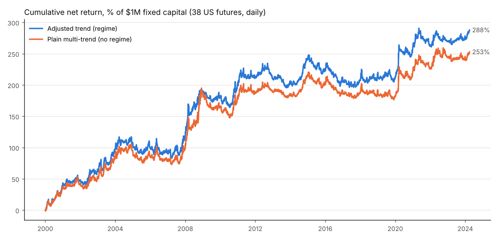

# Adjusted trend backtest: all major US futures

Generated by `python carver_trend/report.py`. Method and assumptions are in `backtest.py`'s docstring and the README.

## Summary

| variant                                         |   ann_return_% |   ann_vol_% |   sharpe |   max_dd_% |   skew_weekly |   worst_day_% |   gross_sharpe |   cost_%/yr |
|:------------------------------------------------|---------------:|------------:|---------:|-----------:|--------------:|--------------:|---------------:|------------:|
| Adjusted trend (regime), 2000-2024              |          11.8  |       18.95 |     0.62 |     -51.72 |         -0.08 |         -8.18 |           0.81 |        3.56 |
| Plain multi-trend (no regime), 2000-2024        |          10.37 |       18.7  |     0.55 |     -47.44 |          0.37 |         -9.31 |           0.72 |        3.11 |
| Adjusted trend, QC 5y window 2019-03 to 2024-03 |          15.52 |       19.72 |     0.79 |     -29.96 |          0.86 |         -8.18 |           0.93 |        2.73 |
| Plain multi-trend, QC 5y window                 |          14.13 |       19.64 |     0.72 |     -22.26 |          0.97 |         -7.94 |           0.84 |        2.36 |
| Adjusted trend, fractional contracts, 2000-2024 |          12.09 |       19.07 |     0.63 |     -45.31 |         -0.06 |         -8.66 |           0.82 |        3.59 |

## Net P&L by asset class, adjusted trend 2000-2024 ($k)

| asset_class   |   net_pnl_$k |
|:--------------|-------------:|
| Ags           |          812 |
| Energy        |          735 |
| Metals        |          438 |
| FX            |          374 |
| Bond          |          304 |
| Equity        |          158 |
| Vol           |           59 |

## Yearly net return, adjusted trend (% of capital)

|          |   2000 |   2001 |   2002 |   2003 |   2004 |   2005 |   2006 |   2007 |   2008 |   2009 |   2010 |   2011 |   2012 |   2013 |   2014 |   2015 |   2016 |   2017 |   2018 |   2019 |   2020 |   2021 |   2022 |   2023 |   2024 |
|:---------|-------:|-------:|-------:|-------:|-------:|-------:|-------:|-------:|-------:|-------:|-------:|-------:|-------:|-------:|-------:|-------:|-------:|-------:|-------:|-------:|-------:|-------:|-------:|-------:|-------:|
| return_% |   40.8 |    7.1 |   17.2 |   32.5 |    9.9 |   -7.5 |     -6 |   22.9 |   72.1 |   -9.4 |   24.4 |    8.3 |   -2.2 |   -4.2 |   35.4 |  -18.7 |  -13.4 |   -1.5 |    7.9 |     -4 |     49 |    1.6 |    7.9 |      7 |   10.9 |

## Per instrument, adjusted trend 2000-2024

| instrument   | name                      | class   |   net_pnl_$k |   sharpe |   avg_|contracts| |
|:-------------|:--------------------------|:--------|-------------:|---------:|------------------:|
| PALLAD       | Palladium                 | Metals  |          287 |     0.57 |              0.89 |
| CRUDE_W      | WTI Crude                 | Energy  |          242 |     0.49 |              1.17 |
| GAS_US       | Natural Gas               | Energy  |          217 |     0.43 |              0.96 |
| SUGAR11      | Sugar #11                 | Ags     |          203 |     0.43 |              4.02 |
| COTTON2      | Cotton #2                 | Ags     |          184 |     0.42 |              1.74 |
| SOYBEAN      | Soybeans                  | Ags     |          173 |     0.39 |              1.89 |
| AUD          | Australian Dollar         | FX      |          149 |     0.34 |              1.81 |
| HEATOIL      | Heating Oil               | Energy  |          147 |     0.28 |              0.72 |
| US5          | 5y T-Note                 | Bond    |          145 |     0.33 |              4.14 |
| GASOILINE    | RBOB Gasoline             | Energy  |          129 |     0.28 |              0.61 |
| EUR          | Euro FX                   | FX      |          102 |     0.26 |              1.02 |
| COPPER       | Copper                    | Metals  |           91 |     0.2  |              1.5  |
| LIVECOW      | Live Cattle               | Ags     |           82 |     0.22 |              2.69 |
| JPY          | Japanese Yen              | FX      |           81 |     0.18 |              1.5  |
| LEANHOG      | Lean Hogs                 | Ags     |           78 |     0.21 |              2.32 |
| FEEDCOW      | Feeder Cattle             | Ags     |           76 |     0.19 |              1.62 |
| SOYOIL       | Soybean Oil               | Ags     |           73 |     0.18 |              3.43 |
| DOW          | Micro E-mini Dow          | Equity  |           72 |     0.18 |             12.25 |
| GBP          | British Pound             | FX      |           71 |     0.16 |              1.8  |
| GOLD         | Gold                      | Metals  |           70 |     0.16 |              1.01 |
| US30         | Ultra T-Bond              | Bond    |           60 |     0.21 |              0.22 |
| US10         | 10y T-Note                | Bond    |           60 |     0.15 |              2.2  |
| VIX          | VIX                       | Vol     |           59 |     0.17 |              1.23 |
| SP500        | E-mini S&P 500            | Equity  |           49 |     0.12 |              1.35 |
| CORN         | Corn                      | Ags     |           45 |     0.11 |              4.03 |
| SOYMEAL      | Soybean Meal              | Ags     |           39 |     0.09 |              2.26 |
| MXP          | Mexican Peso              | FX      |           38 |     0.09 |              4.2  |
| PLAT         | Platinum                  | Metals  |           28 |     0.07 |              1.29 |
| NASDAQ       | E-mini Nasdaq-100         | Equity  |           27 |     0.07 |              1.33 |
| US20         | T-Bond                    | Bond    |           20 |     0.05 |              0.96 |
| US2          | 2y T-Note                 | Bond    |           17 |     0.05 |              6.05 |
| RUSSELL      | Micro E-mini Russell 2000 | Equity  |           11 |     0.06 |              1.62 |
| CAD          | Canadian Dollar           | FX      |           -2 |    -0.01 |              2.32 |
| COFFEE       | Coffee                    | Ags     |           -7 |    -0.02 |              0.46 |
| SILVER       | Silver                    | Metals  |          -40 |    -0.09 |              5.8  |
| WHEAT        | Wheat                     | Ags     |          -41 |    -0.11 |              2.29 |
| CHF          | Swiss Franc               | FX      |          -64 |    -0.12 |              1.44 |
| COCOA        | Cocoa                     | Ags     |          -92 |    -0.21 |              2.47 |
